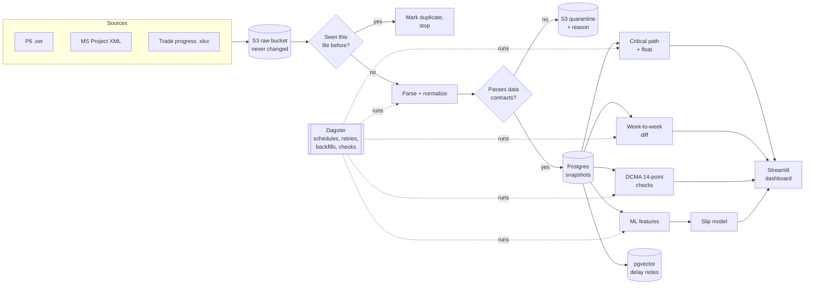

# Baseline

**Know when a data-center project is slipping, before the deadline moves.**

Baseline is a data pipeline for construction schedules. Every week, contractors send updated project schedules from tools like Primavera P6 and Microsoft Project. Baseline collects those files, cleans them up, saves every version exactly as it arrived, and shows you:

- what changed from one week to the next
- how healthy the schedule is
- which tasks are likely to slip next

It is built for large data-center projects, where a single month of delay can cost tens of millions of dollars in lost revenue.

---

## Table of contents

1. [The problem](#1-the-problem)
2. [What Baseline does](#2-what-baseline-does)
3. [Key terms in plain English](#3-key-terms-in-plain-english)
4. [How a file moves through Baseline](#4-how-a-file-moves-through-baseline)
5. [Architecture](#5-architecture)
6. [Tech stack](#6-tech-stack)
7. [Data model](#7-data-model)
8. [Project structure](#8-project-structure)
9. [Getting started](#9-getting-started)
10. [Using Baseline](#10-using-baseline)
11. [Testing](#11-testing)
12. [Design decisions](#12-design-decisions)
13. [Results](#13-results)
14. [Roadmap](#14-roadmap)
15. [Author](#15-author)

---

## 1. The problem

Building a hyperscale data center involves an owner, a general contractor, dozens of trade contractors, equipment suppliers, lenders, and commissioning teams. Each one keeps its own schedule, usually in its own tool or spreadsheet.

That causes three problems:

1. **The files are messy.** Different tools, different formats, missing values, duplicate IDs, and the same file sent twice.
2. **History gets lost.** When a new schedule arrives, the old one is often overwritten. Nobody can easily answer "what did the plan look like six weeks ago?"
3. **Slips are found too late.** A delay usually builds up quietly over many weekly updates. By the time a milestone date moves, it is often too late to recover.

Baseline is built to fix all three.

---

## 2. What Baseline does

| Feature | In simple terms |
|---|---|
| **Reads industry files** | Opens Primavera P6 (`.xer`), Microsoft Project (`.xml`), and Excel progress sheets, and converts them all into one common format. |
| **Rejects bad files safely** | If a file is broken or doesn't follow the rules, it goes into a "quarantine" folder with a clear reason. It never gets half-loaded. |
| **Ignores duplicates** | If the same file is uploaded twice, Baseline recognizes it and does nothing the second time. |
| **Keeps every version** | Every weekly update is saved forever, exactly as it arrived. Nothing is overwritten. |
| **Compares any two weeks** | Pick two dates and see what changed: new tasks, removed tasks, longer durations, broken links, lost buffer time, and changes to the critical path. |
| **Scores schedule health** | Runs the DCMA 14-point check, an industry-standard test for whether a schedule is well built. |
| **Predicts slips** | A machine learning model looks at each task's history and estimates how likely it is to slip in the coming weeks. |
| **Finds similar delays** | Search past delay notes by meaning, for example "switchgear delivery late", and find similar problems on other projects. |
| **Keeps customers separate** | Each customer's data is locked to that customer. Tests prove one customer can never see another's data. |

---

## 3. Key terms in plain English

You don't need a construction background to follow this project. These are the only terms you need.

| Term | What it means |
|---|---|
| **Schedule** | The plan for a project: a list of tasks (called *activities*), how long each one takes, and which tasks depend on which. |
| **Activity** | One task in the schedule, such as "Install switchgear, Building A". |
| **Relationship** | A dependency between two activities. For example, "pour concrete" must finish before "install racks" can start. |
| **Data date** | The date a schedule is "as of". A schedule with data date March 1 shows the plan as it stood on March 1. |
| **Float** | How many days a task can slip without delaying the project's finish. Zero or negative float means no room left. |
| **Critical path** | The chain of tasks with no float. If any one of them slips, the whole project slips. |
| **XER** | The file format Primavera P6 exports. It is a text file made of tables: `%T` lines name a table, `%F` lines list its columns, and `%R` lines hold the rows. |
| **DCMA 14-point check** | A standard checklist, created by the US Defense Contract Management Agency, for judging whether a schedule is built properly. |
| **Snapshot** | One saved version of a schedule for one data date. |
| **Bitemporal** | Tracking two dates for every record: the date the data describes (*data date*) and the date Baseline received it (*ingested at*). This keeps history accurate even when an old update arrives late. |
| **Idempotent** | Running the same step twice gives the same result as running it once. No duplicates, no surprises. |
| **Quarantine** | A holding area for files that failed validation, kept with the reason they failed. |
| **Row-level security (RLS)** | A Postgres feature that filters every query so a user only sees rows belonging to their own customer. |
| **Point-in-time correct** | When building ML features "as of" a date, only data available on that date is used. This prevents the model from cheating by seeing the future. |

---

## 4. How a file moves through Baseline

Here is what happens, step by step, when a contractor uploads a new schedule.

**Step 1: Land the file.**
The file is saved in an S3 "raw" bucket. This copy is never changed or deleted.

**Step 2: Check for duplicates.**
Baseline calculates a fingerprint of the file (a SHA-256 hash). If that fingerprint has been seen before for this customer, the upload is marked as a duplicate and processing stops.

**Step 3: Detect the format.**
Baseline looks at the file and decides which parser to use: P6, MS Project, or Excel.

**Step 4: Parse and normalize.**
The parser reads the file and converts it into Baseline's common schedule format. Dates, units, and IDs are cleaned up in this step.

**Step 5: Validate.**
The cleaned data is checked against data contracts. Examples of rules: every activity has an ID, no two activities share an ID, the data date is not earlier than the previous update, and there are no circular dependencies.

**Step 6a: If it fails, quarantine it.**
The file is moved to the quarantine bucket and a record is written explaining exactly which rule failed.

**Step 6b: If it passes, save a snapshot.**
The schedule is written to Postgres as a new snapshot, inside a single transaction. Either all of it is saved, or none of it is.

**Step 7: Run analysis.**
Baseline recalculates the critical path and float, runs the DCMA checks, compares this snapshot with the previous one, and updates ML features and slip predictions.

**Step 8: Show the results.**
The dashboard updates with the new health score, the changes since last week, and the tasks most at risk.

---

## 5. Architecture



---

## 6. Tech stack

| Layer | Tool | Why this tool |
|---|---|---|
| Language | Python 3.11 | Strong libraries for parsing, data, and ML. |
| File storage | AWS S3 (LocalStack for local development) | Cheap, durable, and supports versioning for immutable raw files. |
| Database | PostgreSQL 16 + pgvector | Schedule data is relational. Postgres handles it well and keeps vector search in the same database. |
| Schema changes | Alembic | Versioned, repeatable database migrations. |
| Orchestration | Dagster | Clear asset dependencies, built-in retries, partitions for backfills, and data quality checks. |
| Validation | Pydantic | Typed models for the canonical schedule format and its rules. |
| ML | LightGBM | Fast and accurate on tabular data, and easy to explain. |
| Dashboard | Streamlit | Quick to build and easy to demo. |
| Infrastructure | Terraform | All AWS resources defined as code. |
| CI/CD | GitHub Actions | Lint, type check, and tests on every push. |
| Testing | pytest | Unit, fuzz, and integration tests. |

---

## 7. Data model

**The core idea:** a schedule update is a fact that never changes. Baseline adds new snapshots; it never edits old ones.

```
tenant ──< project ──< upload ──< snapshot ──< activity
                                      │           │
                                      │           └──< relationship
                                      └──< calendar
```

Read `──<` as "has many". One customer (tenant) has many projects, one project has many uploads, and so on.

### Main tables

| Table | One row means | Important columns |
|---|---|---|
| `tenant` | one customer | `tenant_id`, `region` |
| `project` | one construction project | `project_id`, `tenant_id`, `name` |
| `upload` | one file received | `content_sha256` (unique per tenant), `source_format`, `status`: loaded, quarantined, or duplicate |
| `snapshot` | one schedule for one data date | `tenant_id`, `project_id`, `data_date`, `upload_id`, `ingested_at` |
| `activity` | one task in one snapshot | source activity ID, name, start and finish dates, duration, total float, % complete |
| `relationship` | one dependency in one snapshot | predecessor, successor, type (FS, SS, FF, SF), lag |
| `calendar` | working days and hours | work week, holidays |
| `activity_feature` | one task's ML features as of one date | float trend, progress speed, past slips, predecessor delays |
| `delay_note_embedding` | one delay note as a vector | note text, `embedding` (pgvector) |
| `quarantine_event` | one rejected file | reason code, failed rule, sample of bad rows |

### How the tables are organized

- **Partitioned by tenant**, so each customer's data is stored separately and queries stay fast as data grows.
- **Indexed** on `(project_id, data_date)` and on activity IDs, which are the columns the diff and health queries use most.
- **Row-level security** is on for every table. Each database session sets `app.tenant_id`, and Postgres only returns that tenant's rows.

---

## 8. Project structure

```
baseline/
├── README.md
├── pyproject.toml                  # dependencies, tool settings, CLI entry point
├── Makefile                        # shortcuts: make up / load / test / lint
├── docker-compose.yml              # Postgres + pgvector, LocalStack (S3), Dagster
├── .env.example                    # copy to .env and fill in
├── .gitignore
├── alembic.ini                     # database migration settings
│
├── .github/
│   └── workflows/
│       ├── ci.yml                  # lint, type check, unit + fuzz tests
│       └── terraform.yml           # Terraform format, validate, plan
│
├── docs/
│   ├── design.md                   # trade-offs and why decisions were made
│   ├── data_contracts.md           # validation rules for each file format
│   ├── dcma_checks.md              # how each of the 14 checks is calculated
│   └── architecture.png
│
├── infra/
│   └── terraform/
│       ├── main.tf
│       ├── variables.tf
│       ├── outputs.tf
│       ├── s3.tf                   # raw + quarantine buckets (versioned)
│       ├── rds.tf                  # Postgres database
│       └── iam.tf                  # access permissions
│
├── migrations/                     # Alembic database migrations
│   ├── env.py
│   ├── script.py.mako
│   └── versions/
│       ├── 0001_core_tables.py     # tenant, project, upload, snapshot
│       ├── 0002_activity_relationship_calendar.py
│       ├── 0003_partitions_indexes.py
│       ├── 0004_rls_policies.py
│       └── 0005_features_pgvector.py
│
├── src/
│   └── baseline/
│       ├── __init__.py
│       ├── cli.py                  # commands: load, diff, health, backfill
│       ├── config.py               # settings read from environment variables
│       │
│       ├── ingest/                 # getting files in safely
│       │   ├── __init__.py
│       │   ├── landing.py          # save to S3 raw, compute file fingerprint
│       │   ├── dedupe.py           # skip files already seen
│       │   ├── router.py           # detect format, pick the right parser
│       │   └── quarantine.py       # move bad files + record the reason
│       │
│       ├── parsers/                # reading each file format
│       │   ├── __init__.py
│       │   ├── base.py             # shared parser interface
│       │   ├── xer.py              # Primavera P6
│       │   ├── msp_xml.py          # Microsoft Project
│       │   ├── progress_xlsx.py    # Excel progress sheets
│       │   └── encoding.py         # detect and fix text encodings
│       │
│       ├── canonical/              # the one common schedule format
│       │   ├── __init__.py
│       │   ├── models.py           # Activity, Relationship, Calendar, Snapshot
│       │   ├── normalize.py        # convert each format into the common one
│       │   └── contracts.py        # validation rules + reason codes
│       │
│       ├── db/                     # talking to Postgres
│       │   ├── __init__.py
│       │   ├── session.py          # connection; sets tenant for RLS
│       │   ├── tables.py           # SQLAlchemy table definitions
│       │   └── writer.py           # all-or-nothing snapshot writes
│       │
│       ├── analytics/              # making sense of schedules
│       │   ├── __init__.py
│       │   ├── cpm.py              # critical path method: float calculation
│       │   ├── critical_path.py    # find the critical chain of tasks
│       │   ├── diff.py             # compare two snapshots
│       │   └── dcma.py             # the 14 health checks
│       │
│       ├── ml/                     # predicting slips
│       │   ├── __init__.py
│       │   ├── features.sql        # one feature definition for training + serving
│       │   ├── features.py         # run features.sql as of a given date
│       │   ├── labels.py           # did the task slip within N weeks?
│       │   ├── train.py            # train LightGBM with a time-based split
│       │   ├── predict.py          # score current tasks
│       │   └── embed_notes.py      # turn delay notes into vectors
│       │
│       ├── quality/                # keeping data trustworthy
│       │   ├── __init__.py
│       │   ├── checks.py           # freshness, volume, referential integrity
│       │   └── hashing.py          # table fingerprints for re-run tests
│       │
│       └── orchestration/          # Dagster pipeline
│           ├── __init__.py
│           ├── definitions.py      # Dagster entry point
│           ├── assets.py           # each pipeline step as an asset
│           ├── partitions.py       # split work by project × data date
│           ├── sensors.py          # react to new files in S3
│           ├── schedules.py        # time-based runs
│           ├── checks.py           # Dagster asset checks
│           └── resources.py        # S3 + Postgres connections
│
├── dashboard/
│   ├── app.py                      # Streamlit home page
│   └── pages/
│       ├── 1_project_health.py     # DCMA scores over time
│       ├── 2_snapshot_diff.py      # pick two dates, see what changed
│       ├── 3_slip_risk.py          # tasks most likely to slip
│       └── 4_quarantine.py         # rejected files and why
│
├── scripts/
│   ├── generate_sample_project.py  # builds a realistic 52-week sample project
│   └── seed_tenants.py             # creates demo customers
│
├── sample_data/
│   └── hyperscale_campus/
│       ├── week_01.xer … week_52.xer
│       ├── msp/                    # some MS Project XML versions
│       └── progress/               # messy Excel progress sheets
│
└── tests/
    ├── conftest.py                 # shared Postgres + S3 test setup
    ├── fixtures/                   # small hand-made test files
    ├── unit/                       # one piece at a time
    │   ├── test_xer_parser.py
    │   ├── test_msp_parser.py
    │   ├── test_progress_xlsx.py
    │   ├── test_normalize.py
    │   ├── test_cpm.py
    │   ├── test_diff.py
    │   └── test_dcma.py
    ├── fuzz/                       # deliberately broken files
    │   ├── generators.py           # creates bad files on purpose
    │   └── test_bad_files.py       # each must load or be quarantined
    └── integration/                # the whole system together
        ├── test_idempotency.py     # re-run → identical tables
        ├── test_tenant_isolation.py
        ├── test_point_in_time.py
        └── test_end_to_end.py
```

### Where to start reading the code

If you're new to the repo, read the code in this order:

1. `src/baseline/canonical/models.py`: what a schedule looks like inside Baseline
2. `src/baseline/parsers/xer.py`: how a real P6 file is read
3. `src/baseline/canonical/contracts.py`: what makes a file valid or invalid
4. `src/baseline/db/writer.py`: how snapshots are saved safely
5. `src/baseline/analytics/diff.py`: how two weeks are compared
6. `src/baseline/orchestration/assets.py`: how it all runs together

---

## 9. Getting started

### What you need

- Python 3.11 or newer
- Docker and Docker Compose
- Git
- About 2 GB of free disk space

### Setup

**1. Clone the repo**

```bash
git clone https://github.com/sajansshergill/baseline.git
cd baseline
```

**2. Create your environment file**

```bash
cp .env.example .env
```

The defaults work for local development, so you don't need to change anything yet.

**3. Start Postgres and local S3**

```bash
docker compose up -d
```

This starts Postgres (with pgvector) and LocalStack, which imitates AWS S3 on your machine.

**4. Install Baseline**

```bash
python -m venv .venv
source .venv/bin/activate        # Windows: .venv\Scripts\activate
pip install -e ".[dev]"
```

**5. Create the database tables**

```bash
alembic upgrade head
```

**6. Create demo customers and sample data**

```bash
python scripts/seed_tenants.py
python scripts/generate_sample_project.py
```

### Shortcut

The Makefile runs the same steps:

```bash
make up        # docker compose up
make install   # pip install
make migrate   # alembic upgrade head
make seed      # demo tenants + sample project
make load      # ingest sample schedules
make test      # run unit/integration tests
make dashboard # Streamlit UI
make viz       # 3D campus construction timeline → http://localhost:8765
```

---

## 10. Using Baseline

### Load schedule files

Load all 52 weekly updates of the sample project:

```bash
baseline load sample_data/hyperscale_campus/ --tenant demo_owner
```

Each file ends up as one of three results: **loaded**, **duplicate**, or **quarantined**. A summary prints at the end.

### Compare two weeks

```bash
baseline diff --project hyperscale_campus --from 2026-03-01 --to 2026-04-05
```

The output shows:

- activities added or removed
- duration changes
- dependency changes
- tasks that lost float
- whether the critical path changed

### Check schedule health

```bash
baseline health --project hyperscale_campus --date 2026-04-05
```

This runs all 14 DCMA checks and shows a pass or fail result for each, with the activities that caused any failures.

### Run the pipeline with Dagster

```bash
dagster dev -m baseline.orchestration.definitions
```

Open http://localhost:3000 to see every pipeline step, run backfills, and view data quality check results.

### Open the dashboard

```bash
make dashboard
# or: PYTHONPATH=src:. streamlit run dashboard/app.py
```

Open http://localhost:8501. The dashboard has four pages:

| Page | What you see |
|---|---|
| Project health | DCMA scores over time |
| Snapshot diff | Pick any two dates and see what changed |
| Slip risk | Tasks most likely to slip, with the reasons |
| Quarantine | Rejected files and why they were rejected |

### Open the 3D campus timeline

```bash
make viz
```

Open http://localhost:8765 for an animated Three.js build of the hyperscale campus — scrub weeks, watch critical-path links glow, and see slip-risk structures pulse amber.

---

## 11. Testing

Most pipelines are only tested with clean data. Baseline is tested the way real data actually breaks.

```bash
pytest -q                     # everything
pytest tests/unit -q          # fast tests only
pytest tests/fuzz -q          # broken-file tests
pytest tests/integration -q   # full-system tests (needs Docker running)
```

### What the tests prove

**1. Bad files never corrupt the data.**
The fuzz tests generate broken files on purpose:

- files cut off halfway through
- the wrong text encoding
- two activities with the same ID
- circular dependencies (A depends on B, B depends on A)
- a data date earlier than the previous update
- the same file uploaded twice
- Excel sheets with merged cells, mixed date formats, and missing IDs

Every file must end in exactly one of two ways: **loaded correctly** or **quarantined with a reason**. A half-loaded snapshot counts as a failed test.

**2. Running a step twice changes nothing.**
The idempotency tests run each pipeline step, fingerprint the resulting tables, run the step again, and check that the fingerprints match exactly.

**3. Customers can't see each other's data.**
The tenant isolation tests load data for two customers, then confirm that every query run as customer A returns zero rows belonging to customer B.

**4. The ML model never sees the future.**
The point-in-time tests confirm that features built "as of" a date only use snapshots with a data date on or before that date.

---

## 12. Design decisions

The full reasoning is in [`docs/design.md`](docs/design.md). In short:

**Why Postgres instead of a data warehouse?**
Schedule data is relational: activities, dependencies, and calendars all link to each other. The data is also moderate in size. Postgres with good partitioning and indexes handles this well, and pgvector keeps search in the same database. It's the simplest tool that does the job.

**Why save every version instead of updating rows?**
Contractors sometimes re-send old updates or send corrections late. Saving every version, with both the data date and the received date, keeps the history accurate and makes it possible to compare any two points in time.

**Why check for duplicates first?**
Duplicate uploads are the most common problem in practice. Catching them with a file fingerprint before any parsing is cheaper and safer than cleaning up duplicates afterwards.

**Why quarantine instead of auto-fixing?**
A schedule that breaks the rules is held with a reason, not silently "fixed". Wrong data is worse than late data, because people make decisions on it.

**Why one feature definition for training and predictions?**
If the training features and the live features are calculated differently, the model quietly gets worse. Using the same `features.sql` for both prevents that.

---

## 13. Results

*To be filled in after a full run on the sample project.*

| Metric | Value |
|---|---|
| Weekly updates processed | — |
| Files loaded / duplicates / quarantined | — |
| Fuzz cases passed | — |
| Re-run fingerprint mismatches | — |
| Tenant isolation violations | — |
| Average weeks of warning before a milestone moved | — |
| Slip model precision / recall | — |

---

## 14. Roadmap

- [ ] Change data capture from Postgres using the outbox pattern, so other services can react to new snapshots
- [ ] Column-level data lineage with OpenLineage
- [ ] Deployment across multiple AWS regions to demonstrate data residency end to end
- [ ] Ingestion of field progress data, such as daily reports and photo metadata
- [ ] A REST API (FastAPI) for diffs, health scores, and predictions

---

## 15. Author

**Sajan Shergill**
[Portfolio](https://sajansshergill.github.io) · [LinkedIn](https://linkedin.com/in/sajanshergill) · [GitHub](https://github.com/sajansshergill)
