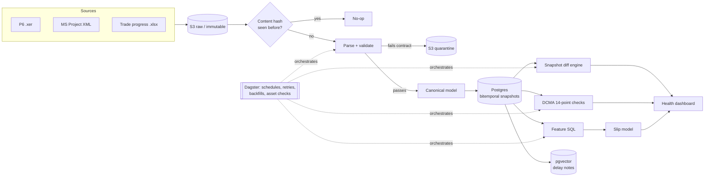

# Baseline

**Schedule intelligence for data-center construction.** Baseline ingests weekly schedule updates from the tools the industry already uses (Primavera P6, MS Project, trade progress spreadsheets), keeps every update exactly as it arrived, and tells you where a project is slipping before the milestone moves.

> A month late on an AI data center can cost tens of millions in lost revenue. The people who could fix a slip usually find out last. Baseline is built to change that, starting with data you can trust.

---

## What it does

| Capability | What that means in practice |
|---|---|
| **Ingest messy industry files** | Parses P6 `.xer`, MS Project XML, and Excel progress sheets into one canonical schedule model. Bad files get quarantined, not loaded. |
| **Preserve every update** | Raw files are immutable in S3. Every update becomes a snapshot in Postgres, keyed by project, data date, and upload. Nothing is overwritten. |
| **Compare any two points in time** | A diff engine shows what changed between any two snapshots: activities added or removed, duration changes, logic changes, float erosion, critical path shifts. |
| **Score schedule health** | Implements the DCMA 14-point assessment (missing logic, hard constraints, negative float, high duration, CPLI, BEI, and the rest). |
| **Predict slips** | Point-in-time-correct features per activity feed a gradient-boosted slip model. Offline training data and online features come from the same SQL. |
| **Search past delays** | Activity names and delay notes are embedded in pgvector, so you can find similar delays across projects. |
| **Isolate every tenant** | Postgres row-level security plus a region column. A test suite proves tenant A can never read tenant B's rows. |

---

## Architecture



---

## Data model

The core idea: **a schedule update is an immutable fact**. Baseline tracks two timelines for every row.

- **Valid time** (`data_date`): the date the schedule is "as of", set by the scheduler.
- **Transaction time** (`ingested_at`): when Baseline received it.

That separation is what lets you answer both *"what did the schedule say on March 1?"* and *"what did we know on March 1?"*, even when a contractor re-issues an old update late.

```
tenant ──< project ──< upload ──< snapshot ──< activity
                                      │           │
                                      │           └──< relationship (pred → succ, type, lag)
                                      └──< calendar
```

Key tables:

| Table | Grain | Notes |
|---|---|---|
| `upload` | one file received | `content_sha256` unique per tenant, `source_format`, `status` (loaded / quarantined / duplicate) |
| `snapshot` | one schedule as of one data date | `(tenant_id, project_id, data_date, upload_id)`; partitioned by `tenant_id` |
| `activity` | one activity in one snapshot | native ID from the source tool, early/late dates, durations, total float, % complete |
| `relationship` | one logic link in one snapshot | FS / SS / FF / SF with lag |
| `activity_feature` | one activity at one point in time | built only from snapshots with `data_date <= as_of` (no leakage) |
| `quarantine_event` | one rejected file | reason code, failing rule, sample rows |

Schema changes are managed with Alembic. Row-level security policies key on `current_setting('app.tenant_id')`.

---

## Repo layout

```
baseline/
├── parsers/
│   ├── xer.py              # %T / %F / %R table parser
│   ├── msp_xml.py          # MS Project XML
│   └── progress_xlsx.py    # messy trade spreadsheets
├── canonical/
│   ├── models.py           # pydantic canonical schedule model
│   └── contracts.py        # data contracts + validation rules
├── db/
│   ├── migrations/         # Alembic
│   └── rls.sql             # row-level security policies
├── analytics/
│   ├── diff.py             # snapshot-to-snapshot diff
│   ├── cpm.py              # critical path + float
│   └── dcma.py             # DCMA 14-point checks
├── ml/
│   ├── features.sql        # shared by training + serving
│   ├── train.py
│   └── embed_notes.py      # pgvector
├── orchestration/          # Dagster assets, sensors, schedules, checks
├── dashboard/              # Streamlit health dashboard
├── infra/                  # Terraform (S3, RDS Postgres, IAM)
├── tests/
│   ├── fuzz/               # bad-file generator
│   ├── test_idempotency.py
│   ├── test_tenant_isolation.py
│   └── test_point_in_time.py
├── sample_data/            # synthetic weekly updates for one data-center project
└── docs/
    └── design.md           # trade-offs and decisions
```

---

## Quickstart

```bash
git clone https://github.com/sajansshergill/baseline.git
cd baseline

# Postgres (with pgvector) + LocalStack for S3
docker compose up -d

pip install -e ".[dev]"
alembic upgrade head

# Load 52 weekly updates of the sample project
python -m baseline.cli load sample_data/hyperscale_campus/

# Start Dagster and the dashboard
dagster dev -m baseline.orchestration
streamlit run dashboard/app.py
```

Compare two snapshots from the command line:

```bash
python -m baseline.cli diff --project hyperscale_campus --from 2026-03-01 --to 2026-04-05
```

---

## Testing: the part most pipelines skip

Baseline is tested the way the data will actually break.

**Bad-file fuzzer.** `tests/fuzz/` generates broken schedules on purpose:

- truncated `.xer` files and wrong encodings
- duplicate activity IDs
- circular logic
- data dates that go backwards
- the same file uploaded twice
- spreadsheets with merged cells, mixed date formats, and missing IDs

Every case must end in one of two outcomes: loaded correctly, or quarantined with a reason code. Never a half-loaded snapshot.

**Idempotency.** Re-running any pipeline, or backfilling any partition, must produce byte-identical tables (checked by hashing table contents).

**Tenant isolation.** With RLS on, every query run as tenant A is checked to return zero rows belonging to tenant B.

**Point-in-time correctness.** Features computed "as of" a date must never use a snapshot with a later data date.

```bash
pytest -q
```

---

## Design decisions

Full write-up in [`docs/design.md`](docs/design.md). The short version:

- **Postgres over a warehouse.** Schedule data is relational (activities, logic links, calendars) and moderate in size. Postgres with good partitioning and indexes is the simplest tool that does the job, and pgvector keeps search in the same database.
- **Bitemporal snapshots over SCD Type 2.** Contractors re-issue old updates. Tracking valid time and transaction time separately keeps history honest when that happens.
- **Content hashing at the door.** Duplicate uploads are the most common failure in practice. Rejecting them before parsing is cheaper than deduplicating after.
- **Quarantine, don't coerce.** A schedule that fails its contract is held with a reason code, not silently fixed. Wrong data is worse than late data.
- **One feature definition.** Training and serving share `features.sql`, so offline and online values can't drift apart.

---

## Results

*To be filled in after the full sample run.*

| Metric | Value |
|---|---|
| Weekly updates processed | — |
| Fuzz cases (loaded / quarantined / failed) | — |
| Re-run hash mismatches | — |
| Tenant-leak test violations | — |
| Slip model lead time before milestone moved | — |

---

## Roadmap

- [ ] CDC from Postgres via the outbox pattern, for downstream consumers
- [ ] OpenLineage for column-level lineage
- [ ] Multi-region deployment to demonstrate data residency end to end
- [ ] Field progress ingestion (daily reports, photos metadata)

---

## Author

**Sajan Shergill** · [Portfolio](https://sajansshergill.github.io) · [LinkedIn](https://linkedin.com/in/sajanshergill) · [GitHub](https://github.com/sajansshergill)
